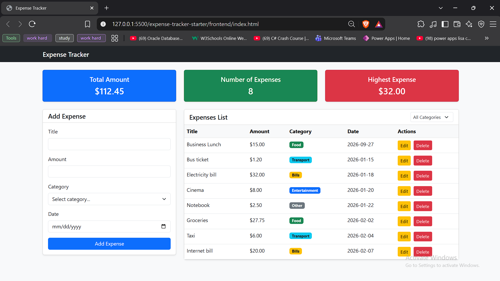

# Expense Tracker

A full-stack web application that allows users to track their daily expenses, categorize them, and view real-time summary metrics.

## How to run

**Backend**

1. Open pgAdmin and create a new database named `expense_tracker`.
2. Open the `backend` folder in VS Code, and run the SQL code inside `schema.sql` in your pgAdmin query tool to create the database table.
3. In the `backend` folder, create a new file named `.env` and add your database credentials:
   ```env
   PORT=3000
   DB_USER=your_postgres_username
   DB_HOST=localhost
   DB_NAME=expense_tracker
   DB_PASSWORD=your_postgres_password
   DB_PORT=5432

4. Open the terminal, navigate to the backend folder (cd backend), and run npm install to install the required dependencies.(cd expense-tracker-starter/backend)

5. Run node server.js to start the backend server on port 3000.

**Frontend**

1. Open the frontend folder in VS Code.

2. Right-click on the index.html file and select "Open with Live Server".

3. The application will open in your default browser and connect to the backend automatically.

## Features

[x] Add an expense (with validation)

[x] Delete an expense

[x] Edit an expense

[x] Filter by category

[x] Summary cards (total, count, highest)

[x] Data is saved in a PostgreSQL database

## Screenshots




## What was the hardest part?

The hardest part was connecting the frontend to the backend API and dynamically displaying the data on the screen. Understanding how to use `fetch` with asynchronous JavaScript (`async/await`) to retrieve data from the database and handle potential server errors was challenging at first. I solved this by breaking the process down: I first ensured the backend API endpoints were working correctly, then wrote a dedicated function to fetch the JSON response, and finally used JavaScript DOM manipulation to loop through the data and generate the HTML table rows dynamically.

## Video
https://drive.google.com/file/d/1G6iT0VC4U6xaxQa9Y2yGpqNM9aPEfy0C/view?usp=sharing